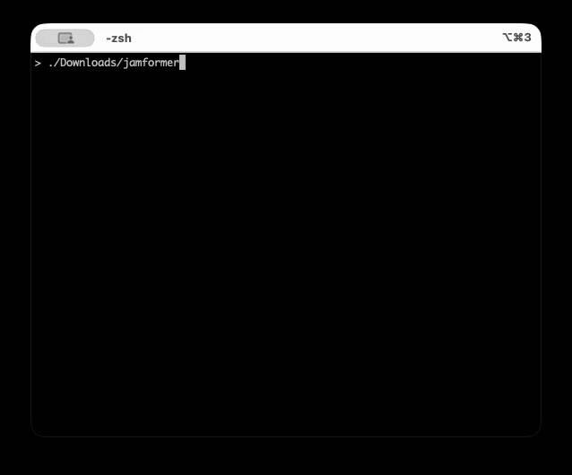

# AI Does My Job Now presentation files

## Install and Setup

- Install [git](https://git-scm.com/install/mac)
- Install [Docker](https://www.docker.com/products/docker-desktop/)
- Download [Jamformer](https://github.com/Jamf-Concepts/jamformer)
- Install [Terraform](https://developer.hashicorp.com/terraform/install)

### Clone with dependencies

Clone the repository and its `docker-jamfpro` submodule together:

```sh
git clone --recurse-submodules https://github.com/magnusviri/ai-does-my-job-now-2026.git
```

For an existing checkout, run:

```sh
git submodule update --init --recursive
```

### Set up Jamf Pro

[`docker-jamfpro`](https://github.com/magnusviri/docker-jamfpro) runs a local Jamf Pro
instance for this demo. It requires Docker, a Jamf Pro development license, and the Jamf
Pro `ROOT.war` file; the Jamf software and license are not included in this repository.

1. In the [Jamf Account portal](https://account.jamf.com/products), download
   the Manual Jamf Pro installer and keep its activation code. Unzip the
   download to obtain `ROOT.war`.
2. Choose the Jamf Pro version from the downloaded installer, then configure
   the submodule. The version must match both the directory name and the
   `JAMF_PRO_VERSION` value.

   ```sh
   cd docker-jamfpro
   cp .env_example .env
   # Edit .env: set JAMF_PRO_VERSION and, if needed, JAMF_IMAGE_VERSION,
   # JAMF_PRO_PORT, and the MySQL credentials.
   mkdir -p data/<jamf-pro-version>
   mv /path/to/ROOT.war data/<jamf-pro-version>/ROOT.war
   ```

3. Start the local services:

   ```sh
   docker compose up -d
   ```

   Jamf Pro can take several minutes to initialize. Browse to
   `http://localhost` (or `http://localhost:<JAMF_PRO_PORT>` if you changed
   the port), accept the license agreement, enter the activation code, and
   complete the initial account setup.

To stop the services later, run `docker compose down` from `docker-jamfpro`.

### Start GitLab

Start the local GitLab server from its Compose directory ("gitlab"):

```sh
cd gitlab
docker compose up -d gitlab
```

GitLab may take several minutes to become available. Open
[http://localhost:8929](http://localhost:8929) for the web interface. Git over
SSH is exposed on port `2424`.

To set or reset the `root` account password after the container is running:

```sh
docker exec -it gitlab gitlab-rake "gitlab:password:reset[root]"
```

Stop the server with `docker compose down gitlab` from the `gitlab` directory. Its
configuration, logs, and data are persisted under `gitlab/gitlab/`.

### GitLab CI/CD

You can't setup CI/CD until you have a repository. Once you have the repository set up,
follow the following instructions.

#### Create GitLab Runner

Start the local GitLab server from its Compose directory ("gitlab"):

```sh
cd gitlab
docker compose up -d gitlab-runner
```

- Go to the [Runner settings](http://localhost:8929/root/jamf1/-/settings/ci_cd#js-runners-settings).
- Create a new project runner.
- Check "Run untagged jobs"
- Click "Create runner" button.
- Copy the token (begins with "glrt-")
- Run the following command (replacing the token with the one you copied)

```
docker compose run --rm gitlab-runner register \
  --non-interactive \
  --url "http://gitlab:8929" \
  --token "glrt-..." \
  --executor "docker" \
  --docker-image "alpine:latest" \
  --description "local-docker-runner"
```

#### Create CI/CD pipeline

Go to the [Pipeline editor](http://localhost:8929/root/jamf-repo/-/ci/editor?branch_name=main).

## The Demos

### Jamformer

Once you have Jamf Pro running locally, run Jamformer.

```
./jamformer
```

[](jamformer.mp4)

Inspect your config files in the "generated" folder with an AI agent.

### Terraform

Add files to git.

```
git init
git add .
git commit -m "1st"
```

Use an AI Agent to change files.

Check for changes.

```
git diff
```

Once you're done inspecting everything and you're happy with it, apply it to the server.

```
terraform apply
```

### GitLab CI/CD
